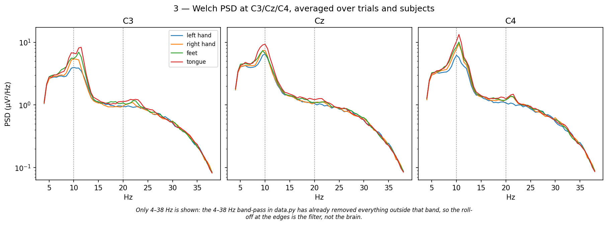
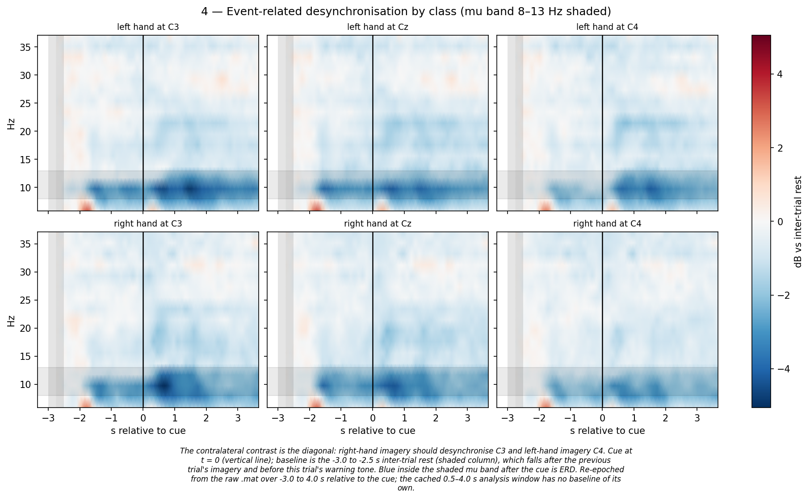
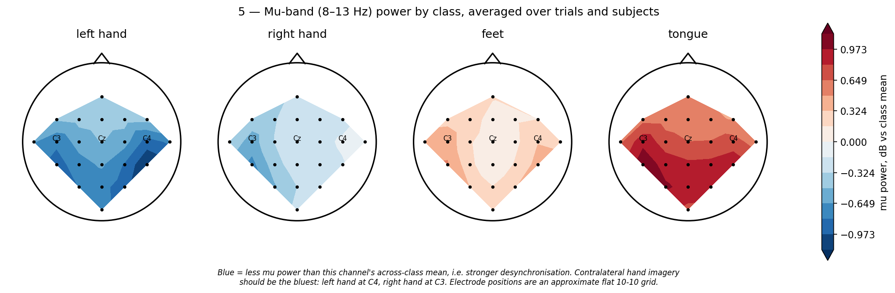
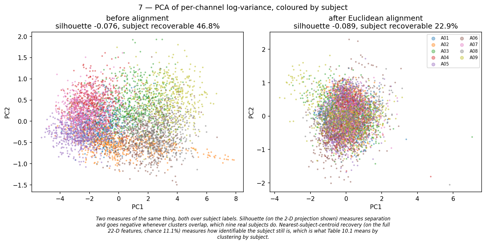

# The data

The nine participants of **BCI Competition IV Dataset 2a**, 744 MB, exactly as the Graz
mirror serves them. GitHub shows *"we can't show files that are this big"* when you click
one — they are 40 MB binary MATLAB files, not text, so there is nothing for it to render.
This page is what they contain.

| File | What |
|---|---|
| `A01T.mat` … `A09T.mat` | participant 1–9, **session 1**, 288 trials each |
| `A01E.mat` … `A09E.mat` | participant 1–9, **session 2**, 288 trials each |
| [`trials.csv`](trials.csv) | **all 5,184 trials as a table** — GitHub renders this one |
| `SHA256SUMS` | checksums, so a copy can be proved identical |

Licence, citation and download: [`../DATA.md`](../DATA.md).

## Inside one file

```
'data' → 9 runs:  runs 0-2  calibration (eyes open, eyes closed, eye movement) — no trials
                  runs 3-8  motor imagery, 48 trials each = 288 trials
each run:
  X       (96735, 25) float64   387 seconds recorded continuously at 250 Hz,
                                22 EEG channels over the scalp plus 3 EOG
  trial   where each trial starts, in samples
  y       what the participant was told to imagine:
          1 left hand   2 right hand   3 feet   4 tongue
  fs      250
```

## The actual numbers

`py phase3/1_environment_setup_and_data_collection/peek.py` prints this for any participant and any trial:

```
A01T.mat: 9 runs, 6 of them motor imagery
  one run is X(96735, 25) float64 - 387 s of continuous recording at 250 Hz, 22 EEG channels plus 3 EOG
  r.trial gives where each of the 48 trials starts, r.y gives its class: ['left hand', 'right hand', 'feet', 'tongue']

TRIAL 0  (run 0, trial 0 within it)  class 4 = tongue
  cut 0.5-4.0 s after the cue -> 22 channels x 875 samples = 3.5 s

  raw microvolts, channels 0-5, samples 0-9:
[[20.51 12.35 10.11  7.81  4.    7.23  5.81  6.59 11.67 10.25]
 [15.28  9.13  7.76  3.42  4.35  6.25  8.64  4.39  6.4   6.45]
 [18.36 11.08  8.94  5.66  2.93  6.74  5.47  7.18 10.99 11.67]
 [25.2  17.24 13.13  5.47  5.08  5.13  8.59  6.49 10.5  10.84]
 [22.07 14.6  11.52  8.64  5.52 10.5   8.01  9.28 14.45 13.67]
 [22.46 16.21 13.48  9.13 10.99 12.21 13.18 10.01 15.67 14.16]]
  over the whole trial: min   -32.3  max   40.7  sd 10.42

what phase3/1_environment_setup_and_data_collection/data.py caches: X(576, 22, 875) float32, y(576,), session(576,), rejected(576,)
  the same trial after the 4-38 Hz band-pass, channels 0-5, samples 0-9:
[[ 8.67  6.08  2.69 -0.21 -1.66 -1.38  0.19  2.13  3.45  3.53]
 [ 4.55  1.9  -0.87 -2.58 -2.87 -2.19 -1.33 -0.76 -0.46 -0.06]
 [ 5.84  2.65 -1.08 -3.96 -5.14 -4.55 -2.76 -0.64  1.02  1.82]
 [10.98  7.13  1.84 -2.79 -5.27 -5.27 -3.54 -1.39  0.11  0.5 ]
 [ 8.84  6.27  2.59 -0.61 -2.17 -1.82 -0.1   1.97  3.36  3.52]
 [ 7.79  6.08  3.41  1.07 -0.08  0.15  1.32  2.78  3.87  4.09]]
  over the whole trial: min   -23.5  max   23.7  sd  6.36
  label 3 = tongue, and the filter removed 39% of the amplitude

  all 576 trials of this subject, {'left hand': 144, 'right hand': 144, 'feet': 144, 'tongue': 144}
  0 marked as artefact-contaminated, 288 from session 2
```

The first block is raw microvolts. The second is the same trial after the 4–38 Hz band-pass,
which is what every model in this repository is fed. Brain signals are **tens of microvolts**
— a single number carries almost nothing. The class lives in how 22 channels move together
over three and a half seconds, which is why this task is hard.

## All 5,184 trials, as a table

[`trials.csv`](trials.csv) reduces each trial to what can honestly be written as one number:
participant, session, class, the artefact flag, three amplitude measures, mu and beta power
at C3 and C4, and the C4/C3 mu ratio in dB. GitHub renders it with sorting and search.

`laterality_db` is the one to look at. Right-hand imagery averages **+1.65 dB** against
left-hand's **+1.04** — the contralateral desynchronisation this whole field rests on,
visible in these recordings (Mann-Whitney p = 9.3 × 10⁻¹³ over 2,592 trials). The spread is
1.9 dB, far wider than that 0.6 dB separation, which is the honest reason four-class
cross-subject accuracy sits near 54% and not near 90%.

## What it looks like



Power spectrum at the three sensorimotor electrodes, averaged over every trial and every
participant.



The effect being decoded: mu-band power drops in the hemisphere opposite the imagined hand,
after the cue at t = 0.



The same effect as scalp maps, one per imagined movement.



The problem this project exists for. The clusters overlap, so the silhouette score is
negative and the picture alone looks like no subject structure at all. The measure that
answers the question is how often a trial's own participant can be recovered from its
channel variances: **46.8% against 11.1% chance**, falling to 22.9% once Euclidean
alignment is applied. Strong subject structure, and a decoder trained on eight people
carries it into the ninth.

All seven analyses: [`../phase3/eda/`](../phase3/eda), produced by `py phase3/2_data_preprocessing_and_eda/explore.py`.

## Opening a file yourself

```python
import scipy.io as sio
m = sio.loadmat("data/A01T.mat", struct_as_record=False, squeeze_me=True)
run = m["data"][3]            # runs 0-2 are calibration
print(run.X.shape, run.y[:10], run.classes)
```

```matlab
load('data/A01T.mat');        % MATLAB, no toolbox needed
size(data{4}.X)
```
